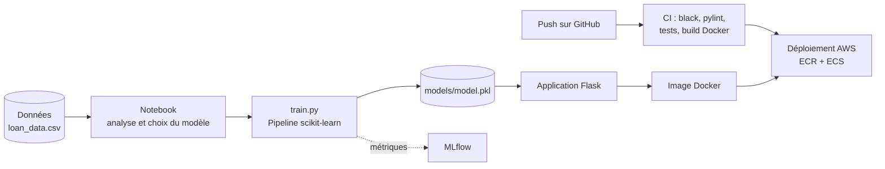

# Prédiction du risque de défaut de paiement : projet MLOps

[](https://github.com/Naomi-na2024/prediction-defaut-credit-mlops/actions/workflows/ci.yml)

Une banque veut savoir, **avant d'accorder ou de renouveler un prêt**, si un client risque de ne pas le rembourser.
Ce projet couvre tout le cycle de vie d'un modèle de Machine Learning : de l'analyse des données jusqu'à une
**application web conteneurisée, testée automatiquement et déployable sur AWS**.


## En bref

| | |
|---|---|
| **Problème** | Classification binaire : le client sera-t-il en défaut de paiement ? |
| **Données** | 10 000 clients, 6 variables financières, 18,5 % de défauts |
| **Modèle retenu** | Arbre de décision (comparé à une régression logistique) |
| **Résultats (jeu de test)** | Accuracy 99,5 % · Précision 98,6 % · Rappel 98,6 % · F1 98,6 % |
| **Mise en production** | API Flask · Docker · CI/CD GitHub Actions · AWS ECR + ECS · suivi MLflow |

## Ce que montre ce projet

- **Analyse exploratoire** : valeurs manquantes, distributions, corrélations, détection des valeurs aberrantes (méthode IQR).
- **Modélisation** : comparaison régression logistique / arbre de décision, gestion du déséquilibre des classes (SMOTE),
  évaluation par matrice de confusion, courbe ROC et importance des variables.
- **Suivi des expériences** avec MLflow (paramètres, métriques, modèles versionnés).
- **Industrialisation** : le prétraitement et le modèle sont regroupés dans un même `Pipeline` scikit-learn, pour que
  l'application applique exactement les mêmes transformations qu'à l'entraînement.
- **Application web** Flask avec formulaire, validation des saisies et API JSON.
- **Qualité et automatisation** : tests `pytest`, formatage `black`, analyse `pylint`, construction et test de l'image
  Docker à chaque push.
- **Déploiement** sur AWS (Amazon ECR + ECS) via GitHub Actions.

## Architecture



## Variables utilisées

| Variable | Description |
|---|---|
| `credit_lines_outstanding` | Nombre de lignes de crédit en cours |
| `loan_amt_outstanding` | Montant du prêt restant à rembourser |
| `total_debt_outstanding` | Dette totale en cours |
| `income` | Revenu annuel |
| `years_employed` | Ancienneté professionnelle (années) |
| `fico_score` | Score de crédit FICO (300 à 850) |

Dans le modèle retenu, le **nombre de lignes de crédit en cours** explique à lui seul près de 90 % des décisions,
suivi de l'ancienneté professionnelle (voir l'analyse détaillée dans le notebook).

## Structure du projet

```
├── app.py                  # Application web Flask + API
├── train.py                # Entraînement reproductible du modèle
├── data/loan_data.csv      # Jeu de données
├── models/                 # Modèle entraîné et ses métriques
├── notebooks/              # Analyse exploratoire et comparaison des modèles
├── templates/, static/     # Interface web
├── tests/                  # Tests automatisés
├── Dockerfile
└── .github/workflows/      # Intégration continue (tests + Docker)
```

## Lancer le projet

**En local**

```bash
git clone https://github.com/Naomi-na2024/prediction-defaut-credit-mlops.git
cd prediction-defaut-credit-mlops
python -m venv venv
source venv/bin/activate          # Windows : venv\Scripts\activate
pip install -r requirements.txt
python app.py                     # puis ouvrir http://localhost:5000
```

**Avec Docker**

```bash
docker build -t prediction-defaut-credit .
docker run -p 5000:5000 prediction-defaut-credit
```

**Réentraîner le modèle et lancer les tests**

```bash
pip install -r requirements-dev.txt
python train.py --mlflow          # enregistre aussi le run dans MLflow (mlflow ui pour le consulter)
pytest -v
```

## Utiliser l'API

```bash
curl -X POST http://localhost:5000/api/predict \
  -H "Content-Type: application/json" \
  -d '{"credit_lines_outstanding": 5, "loan_amt_outstanding": 1958, "total_debt_outstanding": 8228,
       "income": 26648, "years_employed": 2, "fico_score": 572}'
```

Réponse : `{"default": 1, "probability": 1.0}`

## Limites et pistes d'amélioration

- Les données sont très bien séparées (vraisemblablement synthétiques), ce qui explique des scores proches de 100 %.
  Sur des données réelles, il faudrait s'attendre à des performances plus modestes.
- Un arbre de décision non élagué donne des probabilités tranchées (0 % ou 100 %). Un modèle comme
  la forêt aléatoire ou le gradient boosting, ou une calibration des probabilités, donnerait un score plus nuancé.
- Pistes : explicabilité des prédictions (SHAP), surveillance de la dérive des données en production.

## Auteure

**Naomi Nandjui**
[LinkedIn](https://www.linkedin.com/in/blesson-naomi-nandjui-na) · nandjuinaomi@gmail.com

Projet réalisé en septembre 2024. Distribué sous licence MIT.
